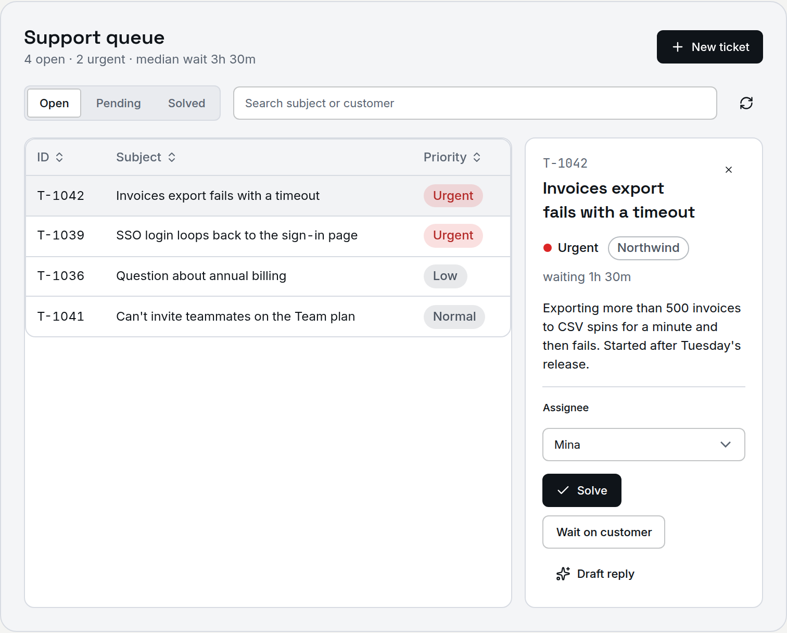
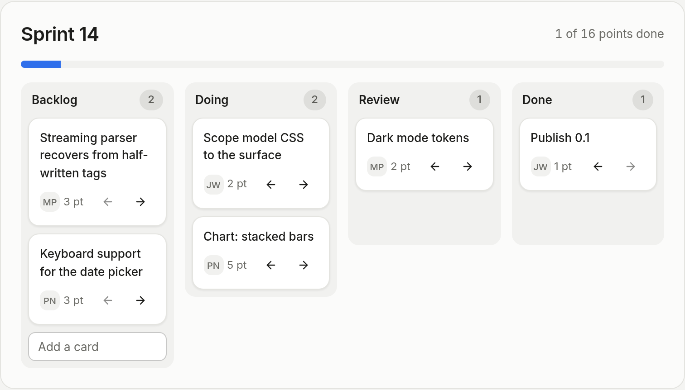
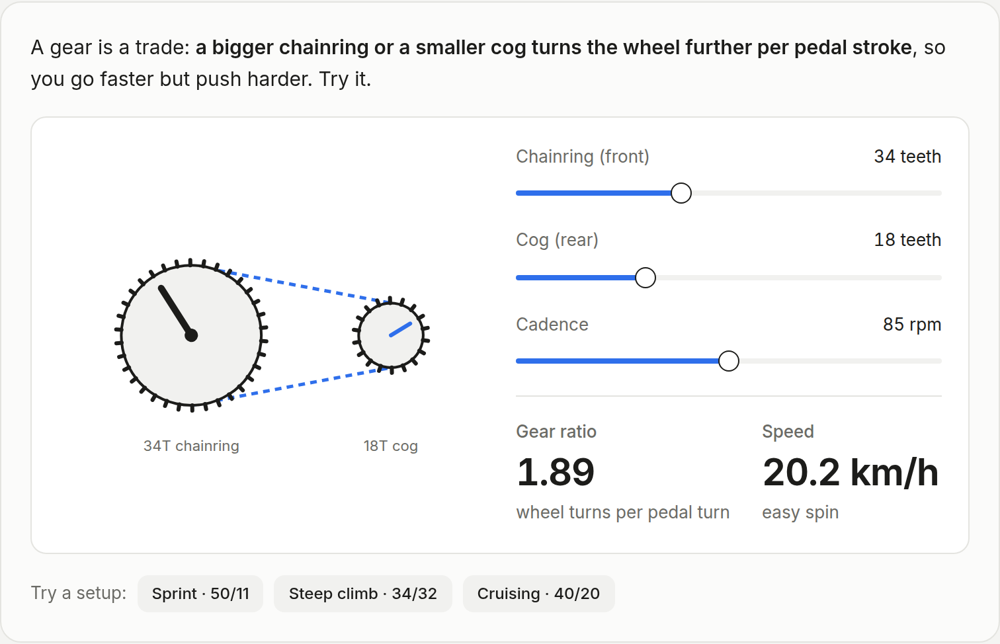

# Open Intelligent UI

[English](README.md) · [中文](README.zh-CN.md)

Let agents author interfaces, not pick them from a component library.

The model writes Markdown mixed with tags. The renderer turns that stream into a live interface: behaviors from [UI SDK](https://ui-sdk.dev/docs), look from a [DESIGN.md](https://github.com/google-labs-code/design.md), motion from design-system tokens and a motion skill. State, data I/O, and handing decisions back to the model are all expressed in the markup.

| | |
| --- | --- |
|  |  |
|  |  |

None of these four is a pre-built component. They live as handwritten IUI markup under `apps/playground/src/demos/` — not model output. This repository has not been run against a real model yet; see [Status](#status).

## Why

A2UI, OpenUI and OpenAI's Intelligent UI all let the model choose and compose from a predefined component catalog. What the catalog has is what the interface can be.

UI SDK is different: it ships component *behaviors* (focus, keyboard, selection, popovers, accessibility) with no look. Hand that to a model and it gets the joints of the building blocks; the shape is up to it. What it still needs is “how it should look” and “how it should move” — DESIGN.md and motion rules fill those gaps.

| Foundation | What it gives | In this repo |
| --- | --- | --- |
| UI SDK | Behaviors for 55 entry points, 367 parts | Lazy-loaded by name; write `<Tabs>`, `<Dialog>`, `<Select>` in markup |
| DESIGN.md | Color, type, radius, spacing, motion tokens, plus prose on how to use them | Tokens become CSS variables; prose goes into the system prompt. Three designs under `design/` |
| Motion skill | Which change gets which motion, and a way to review it frame by frame | `skills/motion/`; markup attributes `motion`, `show`, `stagger`, `morph` |
| Small presets | Content widgets UI SDK does not have | 15 layout primitives; `Chart`, `Stat`, `Number`, `DataTable`, `CodeBlock`, `Skeleton` |

Research and trade-offs, including UI SDK compatibility results, are in [`docs/research.md`](docs/research.md).

## What the markup looks like

```iui
<state saved={1800} goal={12000} monthly={400} />
<derive
  months={ceil(max(goal - saved, 0) / monthly)}
  share={min((saved + monthly * 12) / goal, 1)}
/>

**You reach {currency(goal)} in {months} months.** A year from now you would be {percent(share)} of the way.

<card padding={4}>
  <row gap={4} wrap>
    <svg viewBox="0 0 80 80" width="96" role="img" aria-label="{percent(share)} of the goal after a year">
      <circle cx="40" cy="40" r="32" fill="none" stroke="var(--iui-color-muted)" stroke-width="8" />
      <circle class="ring" cx="40" cy="40" r="32" fill="none" stroke="var(--iui-color-accent)" stroke-width="8" stroke-linecap="round" stroke-dasharray="{share * 201} 201" transform="rotate(-90 40 40)" />
      <text x="40" y="45" text-anchor="middle" font-size="14" font-weight="600" fill="var(--iui-color-foreground)">{percent(share)}</text>
    </svg>
    <box flex={1} minWidth={220} gap={3}>
      <Slider min={50} max={1500} step={50} bind:value={monthly}>
        <row><text size="sm" color="muted">Set aside each month</text><spacer /><text size="sm" weight="medium" tabular>{currency(monthly)}</text></row>
        <SliderControl><SliderTrack><SliderIndicator /><SliderThumb aria-label="Monthly amount" /></SliderTrack></SliderControl>
      </Slider>
      <Button variant="solid" on:click={send("Set up a monthly transfer of " + currency(monthly), { monthly, months })}>Start saving {currency(monthly)} a month</Button>
    </box>
  </row>
</card>

<style>
  .ring { transition: stroke-dasharray var(--iui-motion-layout-duration) var(--iui-motion-layout-easing); }
</style>
```

- `<state>` and `<derive>` are what the interface remembers and what it computes from that.
- `<Slider>` is a UI SDK behavior; `bind:value` wires it to state. Dragging updates the sentence, the ring and the button label with no model call.
- The ring is not a component — SVG the model drew, colored and timed from design tokens.
- `send()` hands the reader's decision and data back to the model for the next turn.
- With tools wired up, `<query>` reads and `call()` writes, so the surface becomes a read/write workbench without the model in the loop.

Full language: [`docs/spec.md`](docs/spec.md).

## Try it

Node 22+ and pnpm.

```bash
pnpm install
pnpm dev
```

Open <http://localhost:5173> (or the [deployed playground](https://open-intelligent-ui-one.vercel.app)). Six demos on the left; switch streaming speed, design, light/dark and width. Inspect shows markup, state and the system prompt. For a real model, pick **Live** and choose OpenAI, Anthropic, DeepSeek or a custom OpenAI-compatible endpoint — the key stays in this tab.

```bash
pnpm test
pnpm typecheck
pnpm design:lint      # DESIGN.md CLI on design/
pnpm check:packages   # build both packages and check the tarballs npm would get
```

## Integrate

```bash
npm install @open-intelligent-ui/react @open-intelligent-ui/core @ui-sdk/react @ui-sdk/core
```

`open-intelligent-ui`, without a scope, is the same project: it re-exports `@open-intelligent-ui/core`.

```tsx
import { buildSystemPrompt } from "@open-intelligent-ui/core/prompt"
import { IntelligentUI } from "@open-intelligent-ui/react"
import "@open-intelligent-ui/react/styles.css"

const system = buildSystemPrompt({ design, tools: toolDescriptions })

<IntelligentUI
  source={replySoFar}
  streaming={isStreaming}
  design={design}
  tools={{ listTickets, updateTicket }}
  onAction={(action) => {
    if (action.type === "send") askModel(action.text, action.data, action.state)
  }}
/>
```

Both packages are ESM with type declarations; the React entry is marked `"use client"`. Tools, theming, host components, state and the safety model: [`skills/intelligent-ui/references/integration.md`](skills/intelligent-ui/references/integration.md).

## Layout

```
packages/core     Markup parser, expression interpreter, state store, DESIGN.md, system prompt. No framework.
packages/react    React renderer, primitives, presets, styles
packages/open-intelligent-ui   The unscoped npm name; re-exports packages/core
apps/playground   Demo site
design/           Three DESIGN.md files: Paper, Heritage, Signal
skills/           Agent skills: intelligent-ui and motion
docs/             Research, language spec, architecture
scripts/          UI SDK catalog generation, skill references, design lint
```

## Docs

| Doc | Contents |
| --- | --- |
| [`docs/research.md`](docs/research.md) | A2UI, OpenUI, OpenAI Intelligent UI, UI SDK, DESIGN.md; compatibility tests; presets and state syntax |
| [`docs/spec.md`](docs/spec.md) | IUI markup language |
| [`docs/architecture.md`](docs/architecture.md) | How the pieces fit, data flow, safety model, tests |
| [`skills/intelligent-ui/SKILL.md`](skills/intelligent-ui/SKILL.md) | For agents: writing and integrating interfaces |
| [`skills/motion/SKILL.md`](skills/motion/SKILL.md) | For agents: designing and reviewing motion |

## Status

A working prototype, not a product.

- **Not validated against a real model.** Demos are handwritten. Every example in the system prompt is rendered by tests; how a model writes against that prompt, and at what token cost, is unknown.
- **UI SDK is beta** (0.1.0-beta.13). After upgrading, run `pnpm generate`; tests will flag drift.
- **React renderer only**, React 19+. UI SDK also ships Vue, Svelte, Solid and web-component packages with the same component names, and `packages/core` and the stylesheet do not depend on a framework, but no other renderer has been written. See [`docs/research.md`](docs/research.md#其他框架).
- **Visual checks only in desktop Chrome.** Layout morphing needs View Transitions; unsupported browsers swap instantly.
- **Safety model has not been audited externally.** Markup is never executed as code; authorizing tool calls is the host's job.
- **Unlayered host CSS can override the surface.** Put resets in a cascade layer when integrating.

## License

MIT. Files generated from UI SDK remain Apache-2.0; see [`NOTICE`](NOTICE).
