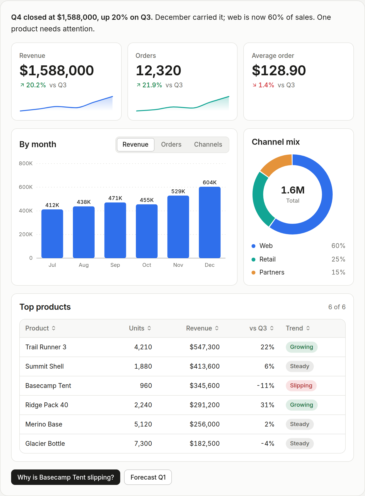

# Open Intelligent UI

[English](README.md) · [中文](README.zh-CN.md)

Agents write the interface themselves. Focus, keyboard, selection, popovers and accessibility come from [UI SDK](https://ui-sdk.dev/docs) behaviors, and the look is not locked inside a component. Color, type, radius and spacing follow your [DESIGN.md](https://github.com/google-labs-code/design.md): tokens for the interface, written guidance for the model. A screen does not have to be turned into a component and filed in a catalog first.

[Documentation](https://open-intelligent-ui.pages.dev/docs/) ([中文](https://open-intelligent-ui.pages.dev/docs/zh/)), with every example drawn live · [Playground](https://open-intelligent-ui.pages.dev)

The model writes Markdown mixed with tags. The renderer turns that stream into a live interface. UI SDK supplies the behavior of 55 widgets, so the model lays them out in your design and does not reimplement keyboard or screen-reader behavior. DESIGN.md tokens become CSS variables, and its guidance goes into the system prompt, so a different design changes both the picture and the model's choices. Motion comes from the design system's motion tokens and a motion skill. State, data I/O, and handing a decision back to the model are written in the markup.

| | |
| --- | --- |
|  |  |
|  |  |

None of these four is a pre-built component. The markup is handwritten under `apps/playground/src/demos/`. This repository has not been run against a real model yet; see [Status](#status).

## Why

A2UI, OpenUI and OpenAI's Intelligent UI all let the model choose and compose from a predefined component catalog. What the catalog has is what the interface can be: behavior and look are bound to the same component, so a new shape means registering a new component first.

This project separates the two. UI SDK supplies behavior only, and the model decides the shape with layout, SVG and CSS. DESIGN.md says how that shape is chosen: color, type, radius, spacing and motion, read by both the renderer and the model. The motion rules then say which kind of change gets which motion.

| Foundation | What it gives | In this repo |
| --- | --- | --- |
| UI SDK | Behaviors for 55 entry points, 367 parts | Lazy-loaded by name; write `<Tabs>`, `<Dialog>`, `<Select>` in markup |
| DESIGN.md | Color, type, radius, spacing, motion tokens, plus prose on how to use them | Tokens become CSS variables; prose goes into the system prompt. Four designs come with the package: `import { paper, noir, heritage, signal } from "@open-intelligent-ui/core/designs"` |
| Motion skill | Which change gets which motion, and a way to review it frame by frame | `skills/motion/`; markup attributes `motion`, `show`, `stagger`, `morph` |
| Small presets | Content widgets UI SDK does not have | 15 layout primitives; `Chart`, `Stat`, `Number`, `DataTable`, `CodeBlock`, `Skeleton` |

### Why not HTML?

A2UI and OpenUI both argue against letting the model emit a full HTML page (often with JS in an iframe). That argument holds here, with one addition: IUI does allow whitelisted HTML and SVG as drawing material. The contract we reject is this one: the model writes an executable page, and the host sandboxes it.

That contract fails on safety without isolation, design-system continuity, real widget behavior (focus, keyboard, a11y), client-side state and tools, streaming half-trees, and cross-framework renderers. Catalog GenUI fixes those by locking the model to registered components; open-ended HTML/JS frees the shape and loses the rest. This project is freer than composing from a catalog, and it does not run arbitrary code. A2UI named that position and left it empty. Full argument: [`docs/research.md`](docs/research.md#为什么不是-html).

Research and trade-offs, including UI SDK compatibility results, are in [`docs/research.md`](docs/research.md).

## What the markup looks like

```iui
<state saved={1800} goal={12000} monthly={400} />
<derive
  months={ceil(max(goal - saved, 0) / monthly)}
  share={min((saved + monthly * 12) / goal, 1)}
/>

**You reach {currency(goal)} in {months} months.** A year from now you would be {percent(share)} of the way.

<card padding={4}>
  <row gap={4} wrap>
    <svg viewBox="0 0 80 80" width="96" role="img" aria-label="{percent(share)} of the goal after a year">
      <circle cx="40" cy="40" r="32" fill="none" stroke="var(--iui-color-muted)" stroke-width="8" />
      <circle class="ring" cx="40" cy="40" r="32" fill="none" stroke="var(--iui-color-accent)" stroke-width="8" stroke-linecap="round" stroke-dasharray="{share * 201} 201" transform="rotate(-90 40 40)" />
      <text x="40" y="45" text-anchor="middle" font-size="14" font-weight="600" fill="var(--iui-color-foreground)">{percent(share)}</text>
    </svg>
    <box flex={1} minWidth={220} gap={3}>
      <Slider min={50} max={1500} step={50} bind:value={monthly}>
        <row><text size="sm" color="muted">Set aside each month</text><spacer /><text size="sm" weight="medium" tabular>{currency(monthly)}</text></row>
        <SliderControl><SliderTrack><SliderIndicator /><SliderThumb aria-label="Monthly amount" /></SliderTrack></SliderControl>
      </Slider>
      <Button variant="solid" on:click={send("Set up a monthly transfer of " + currency(monthly), { monthly, months })}>Start saving {currency(monthly)} a month</Button>
    </box>
  </row>
</card>

<style>
  .ring { transition: stroke-dasharray var(--iui-motion-layout-duration) var(--iui-motion-layout-easing); }
</style>
```

- `<state>` and `<derive>` are what the interface remembers and what it computes from that.
- `<Slider>` is a UI SDK behavior; `bind:value` wires it to state. Dragging updates the sentence, the ring and the button label with no model call.
- The ring is SVG the model drew, colored and timed from design tokens.
- `send()` hands the reader's decision and data back to the model for the next turn.
- With tools wired up, `<query>` reads and `call()` writes, so the surface becomes a read/write workbench without the model in the loop.

Full language: [`docs/spec.md`](docs/spec.md).

## Try it

Node 22+ and pnpm.

```bash
pnpm install
pnpm dev
```

Open <http://localhost:5173> (or the [deployed playground](https://open-intelligent-ui.pages.dev); Vercel mirror: [open-intelligent-ui-sdk.vercel.app](https://open-intelligent-ui-sdk.vercel.app)). Eleven demos on the left; switch renderer, streaming speed, design, light/dark and width. Inspect shows markup, state and the system prompt. For a real model, pick Live and choose OpenAI, Anthropic, DeepSeek or a custom OpenAI-compatible endpoint. The key stays in this tab.

```bash
pnpm test
pnpm typecheck
pnpm design:lint      # DESIGN.md CLI on design/
pnpm check:packages   # build the packages and check the tarballs npm would get
```

## Integrate

```bash
npm install @open-intelligent-ui/react @open-intelligent-ui/core @ui-sdk/react @ui-sdk/core
```

`open-intelligent-ui`, without a scope, is the same project: it re-exports `@open-intelligent-ui/core`.

```tsx
import { buildSystemPrompt } from "@open-intelligent-ui/core/prompt"
import { IntelligentUI } from "@open-intelligent-ui/react"
import "@open-intelligent-ui/react/styles.css"

const system = buildSystemPrompt({ design, tools: toolDescriptions })

<IntelligentUI
  source={replySoFar}
  streaming={isStreaming}
  design={design}
  tools={{ listTickets, updateTicket }}
  onAction={(action) => {
    if (action.type === "send") askModel(action.text, action.data, action.state)
  }}
/>
```

There is a renderer for each framework UI SDK supports. Each takes the same props, and each is installed with the UI SDK package it is built on:

| Package | For | Built on |
| --- | --- | --- |
| [`@open-intelligent-ui/react`](packages/react) | React 19 or later | `@ui-sdk/react` |
| [`@open-intelligent-ui/vue`](packages/vue) | Vue 3.5 or later | `@ui-sdk/vue` |
| [`@open-intelligent-ui/svelte`](packages/svelte) | Svelte 5.33 or later | `@ui-sdk/svelte` |
| [`@open-intelligent-ui/solid`](packages/solid) | Solid 2 | `@ui-sdk/solid` |
| [`@open-intelligent-ui/web`](packages/web) | No framework: the `<intelligent-ui>` element, or `mount()` | `@ui-sdk/web` |

On Vue:

```bash
npm install @open-intelligent-ui/vue @open-intelligent-ui/core @ui-sdk/vue @ui-sdk/core
```

```vue
<script setup lang="ts">
import { IntelligentUI } from "@open-intelligent-ui/vue"
import "@open-intelligent-ui/vue/styles.css"
</script>

<template>
  <IntelligentUI
    :source="replySoFar"
    :streaming="isStreaming"
    :design="design"
    :tools="{ listTickets, updateTicket }"
    :on-action="onAction"
  />
</template>
```

On a page with no framework:

```bash
npm install @open-intelligent-ui/web @open-intelligent-ui/core @ui-sdk/web @ui-sdk/core
```

```html
<intelligent-ui id="reply"></intelligent-ui>

<script type="module">
  import "@open-intelligent-ui/web/define"
  import "@open-intelligent-ui/web/styles.css"

  const reply = document.querySelector("#reply")
  reply.design = design
  reply.tools = { listTickets, updateTicket }
  reply.addEventListener("action", (event) => {
    if (event.detail.type === "send") askModel(event.detail.text, event.detail.data, event.detail.state)
  })
  reply.streaming = isStreaming
  reply.source = replySoFar
</script>
```

Svelte and Solid look like React and Vue; each package's README has its example and what differs in that framework.

A model writes the same markup for all five, and the prompt is the same. React, Vue and Solid draw it to the same DOM. Svelte draws the same DOM apart from a few elements `@ui-sdk/svelte` places differently. The web renderer draws UI SDK components as custom elements (`<ui-tabs>`), with the same roles, names, states and look.

The [demo site](https://open-intelligent-ui.pages.dev) (Vercel: [open-intelligent-ui-sdk.vercel.app](https://open-intelligent-ui-sdk.vercel.app)) switches between the five on one reply. `pnpm dev:vue`, `pnpm dev:svelte`, `pnpm dev:solid` and `pnpm dev:web` each run the same demos on one renderer alone.

The packages are ESM with type declarations; the React entry is marked `"use client"`. Tools, theming, host components, state and the safety model: [`skills/intelligent-ui/references/integration.md`](skills/intelligent-ui/references/integration.md).

### Check the reply

A reply can be checked before a reader sees it, on the server, and the model can be asked to fix what is wrong:

```ts
import { checkMarkup, repairMessage } from "@open-intelligent-ui/core/check"

let reply = await model(messages)
let result = checkMarkup(reply, { library, tools })
for (let round = 0; !result.ok && round < 2; round++) {
  messages.push({ role: "assistant", content: reply }, { role: "user", content: repairMessage(result) })
  reply = await model(messages)
  result = checkMarkup(reply, { library, tools })
}
```

`checkMarkup` reads the reply the way a renderer would, without drawing it. Each issue has a code, a line, the line's text and, where it can be said, what to write instead: a component or a name that doesn't exist, a prop a primitive doesn't have, a handler that would fail when pressed, markup written as JSX, a tool the product doesn't have. While a reply streams, the renderers hold back a warning about a name the stream hasn't declared yet, and give it at the end if the name is still missing. More: [Correct output](https://open-intelligent-ui.pages.dev/docs/guide/correctness/).

## Customize

What a product adds or replaces goes in one `library`, which the renderer and the prompt both read. The model is told about exactly what the renderer can draw.

```ts
import { defineComponent, defineLibrary, defineWidget, view } from "@open-intelligent-ui/core"
import { echartsCharts } from "@open-intelligent-ui/core/charts"
import { motionAdapter } from "@open-intelligent-ui/core/motion"
import { animate } from "motion"

const OrderCard = defineComponent({
  name: "OrderCard",
  description: "One order with its status and total. Use it wherever an order is shown.",
  props: { order: { type: "object", required: true }, tone: ["neutral", "urgent"] },
  events: { open: "The card was pressed; $value is the order id." },
  example: `<OrderCard order={order} on:open={picked = $value} />`,
  component: OrderCardView,
})

export const library = defineLibrary({
  design: herouiDesignMd,                           // any DESIGN.md, HeroUI's included
  components: [OrderCard, Steps],                   // your components, and widgets written once for all five renderers
  charts: echartsCharts(() => import("echarts")),   // or g2Charts, rechartsCharts, your own engine
  motion: motionAdapter(animate),                   // or gsapAdapter, waapiAdapter, your own adapter
})
```

```tsx
<IntelligentUI source={replySoFar} library={library} />

buildSystemPrompt({ library })   // describes OrderCard and Steps from their definitions
```

| To change | Use | The prompt |
| --- | --- | --- |
| The design | `design`: a DESIGN.md, one written for another library (its CSS variables are read), or `designFromCss(themeCss)` | Lists the design's tokens and its guidance |
| Fixed components the model must use | `defineComponent`: a framework component with declared props, events and an example | A section per component, generated from the definition |
| More preset widgets | `defineWidget`: drawn with framework-neutral views, so one definition runs in React, Vue, Svelte, Solid and Web Components | The same |
| What draws `<Chart>` | `echartsCharts`, `g2Charts`, `rechartsCharts` (React), or a `ChartEngine` of your own | Adds the chart types the engine brings |
| What plays motion | `motionAdapter`, `gsapAdapter`, `waapiAdapter`, or `createMotionAdapter` | Adds the entrances you define |

Markup passes a registered component only the props it declares, with values of the declared type. `librarySpec(library)` writes the library as JSON, for a server that builds the prompt without loading the UI, and `validateLibrary(library)` checks descriptions and examples in a test. Every option: [`docs/extending.md`](docs/extending.md).

## Layout

```
packages/core     Markup parser, expression interpreter, state store, DESIGN.md, system prompt. No framework.
packages/core/src/renderer   What every renderer shares: directives, primitives, presets, charts. packages/core/styles is the stylesheet.
packages/react    React renderer, on @ui-sdk/react
packages/vue      Vue renderer, on @ui-sdk/vue
packages/svelte   Svelte renderer, on @ui-sdk/svelte
packages/solid    Solid renderer, on @ui-sdk/solid
packages/web      Web Components renderer, on @ui-sdk/web: <intelligent-ui> and mount()
packages/open-intelligent-ui   The unscoped npm name; re-exports packages/core
apps/playground   Demo site (React), with a switch that draws a reply with any of the five renderers
apps/docs         Documentation site (Next.js, Fumadocs and HeroUI), in English and Chinese, built into the demo site under /docs
apps/vue-demo, apps/svelte-demo, apps/solid-demo, apps/web-demo   The same demos on one renderer each
design/           Four DESIGN.md files: Paper, Noir, Heritage, Signal. third-party/ holds HeroUI's, as published
skills/           Agent skills: intelligent-ui and motion
docs/             Research, language spec, architecture
scripts/          UI SDK catalog generation, skill references, design lint
```

## Docs

| Doc | Contents |
| --- | --- |
| [The documentation site](https://open-intelligent-ui.pages.dev/docs/) | Guides with live examples: the markup, data and tools, design, your components, charts, motion, correct output, safety, API |
| [`docs/research.md`](docs/research.md) | A2UI, OpenUI, OpenAI Intelligent UI, UI SDK, DESIGN.md; compatibility tests; presets and state syntax |
| [`docs/spec.md`](docs/spec.md) | IUI markup language |
| [`docs/architecture.md`](docs/architecture.md) | How the pieces fit, data flow, safety model, tests |
| [`docs/extending.md`](docs/extending.md) | Replacing the design, charts and motion; registering components and widgets; how the prompt follows |
| [`skills/intelligent-ui/SKILL.md`](skills/intelligent-ui/SKILL.md) | For agents: writing and integrating interfaces |
| [`skills/motion/SKILL.md`](skills/motion/SKILL.md) | For agents: designing and reviewing motion |

## Status

A working prototype, not a product.

- **Measured against one model only.** 32 replies written by one strong model against the default prompt all drew without a warning, and the checker found one latent mistake in them, which is now supported. Replies from smaller or cheaper models, the pass rate after repair on a real workload, and token cost have not been measured. Demos are handwritten; every demo and every documented example is drawn and checked by tests.
- **UI SDK is beta** (0.1.0-beta.13). After upgrading, run `pnpm generate`; tests will flag drift.
- **Five renderers: React, Vue, Svelte, Solid and Web Components.** Tests draw every sample in this repository with React and with each of the other four, and compare what is drawn and the warnings. The four are new: beyond those tests each has been compared with React in desktop Chrome on the demos, and none has been used in a product. Hydrating server-rendered HTML is untested. See [`docs/research.md`](docs/research.md#其他框架).
- **Visual checks only in desktop Chrome.** Layout morphing needs View Transitions; unsupported browsers swap instantly.
- **Safety model has not been audited externally.** Markup is never executed as code; authorizing tool calls is the host's job.
- **Unlayered host CSS can override the surface.** Put resets in a cascade layer when integrating.

## License

MIT. Files generated from UI SDK remain Apache-2.0; see [`NOTICE`](NOTICE).
