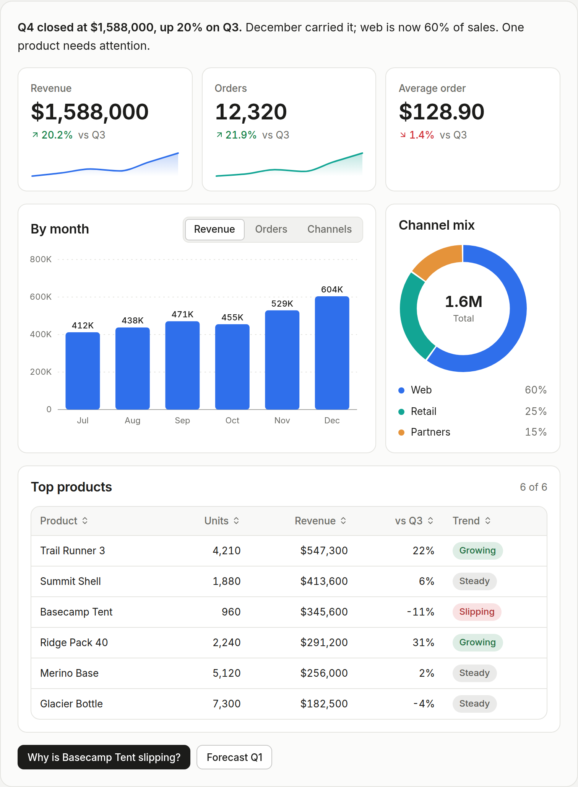
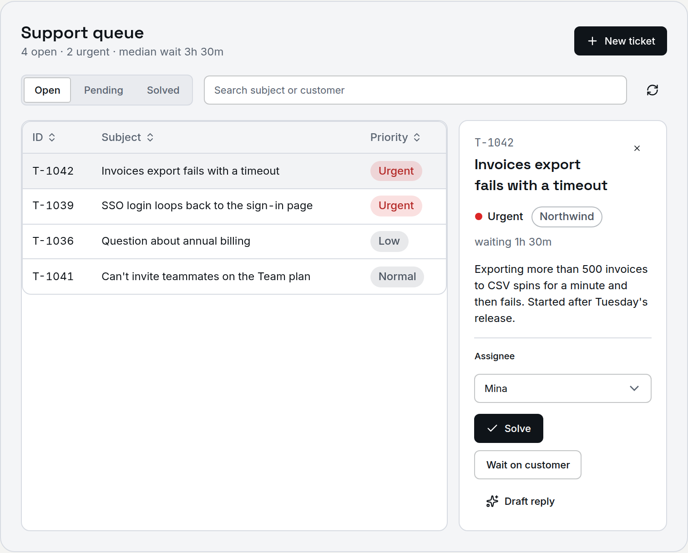
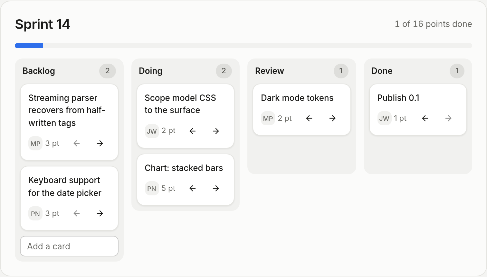
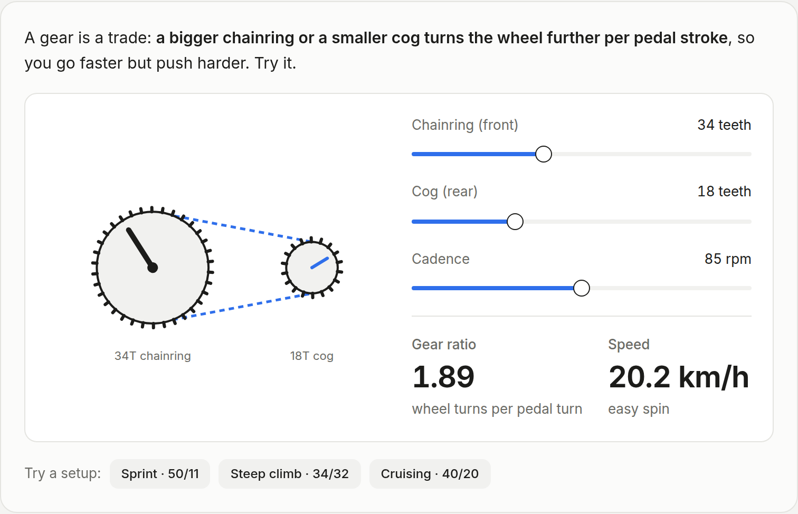

# Open Intelligent UI

<p align="center">
  
</p>

[English](README.md) · 中文

智能体自己写界面。控件的焦点、键盘、选中、弹层和无障碍用 [UI SDK](https://ui-sdk.dev/docs) 现成的行为，外观不锁在组件里；颜色、字体、圆角、间距跟你的 [DESIGN.md](https://github.com/google-labs-code/design.md) 走，令牌给界面用，说明给模型读。屏幕不必先做成组件放进目录。

[文档](https://open-intelligent-ui.pages.dev/docs/zh/)（[English](https://open-intelligent-ui.pages.dev/docs/)），每个例子都实时渲染 · [演示站](https://open-intelligent-ui.pages.dev)

模型写 Markdown 加标签的标记，渲染器边流边把它变成可以操作的界面。UI SDK 有 55 个控件的行为，模型按你的设计来排，不用重写键盘和读屏该做的事。DESIGN.md 的令牌变成 CSS 变量，说明文字进入系统提示词，换一份设计时，画面和模型的判断一起换。动效来自设计系统里的动效令牌和一个 motion skill。状态、数据读写和把决定交还给模型，都写在标记里。

| | |
| --- | --- |
|  |  |
|  |  |

这四个界面都是一段标记，没有一个是预先写好的组件。它们在 `apps/playground/src/demos/` 里，是手写的示例标记，不是模型的输出；本仓库还没有用真实模型跑过，见[现状与限制](#现状与限制)。

## 为什么

A2UI、OpenUI 和 OpenAI 的智能界面都让模型在一个预先定义的组件库里选择和组合。库里有什么，界面就只能是什么：行为和外观捆在同一个组件上，要一个新样子，就得先注册一个新组件。

这里把两件事拆开。UI SDK 只给行为，模型用布局、SVG 和 CSS 决定外形。DESIGN.md 规定外形怎么取：颜色、字体、圆角、间距、动效，渲染器和模型读的是同一份。动效规则再规定什么样的变化配什么样的动效。

| 地基 | 提供什么 | 在这个仓库里 |
| --- | --- | --- |
| UI SDK | 55 个入口、367 个部件的交互行为 | 按名字懒加载，标记里直接写 `<Tabs>`、`<Dialog>`、`<Select>` |
| DESIGN.md | 颜色、字体、圆角、间距、动效令牌，以及怎么用它们的说明 | 令牌变成 CSS 变量，正文进系统提示词。包里自带四套：`import { paper, noir, heritage, signal } from "@open-intelligent-ui/core/designs"` |
| 动效 skill | 什么变化配什么动效，以及在浏览器里逐帧检查的方法 | `skills/motion/`，标记属性 `motion`、`show`、`stagger`、`morph` |
| 少量预置 | UI SDK 没有的内容类组件 | 15 个布局原语，`Chart`、`Stat`、`Number`、`DataTable`、`CodeBlock`、`Skeleton` |

### 为什么不是 HTML？

A2UI 和 OpenUI 都反对模型直接吐出一整页 HTML（往往还带着 JS，塞进 iframe）。这个判断在这里成立，要补上一句：IUI 允许白名单里的 HTML 和 SVG 当画材。我们反对的契约是：模型写可执行的网页，宿主用沙箱兜着。

这份契约在几件事上同时垮掉：不靠隔离的安全、设计系统能不能跟进去、真正的控件行为（焦点、键盘、无障碍）、端侧状态和工具、半截树的流式渲染、以及跨框架落地。目录式 GenUI 用「只能用注册过的组件」修好了这些，却锁死了外形；开端 HTML/JS 放开外形，其余又丢回去。本方案比从目录组合更自由，又不执行任意代码。A2UI 标出过这个位置，没有给出做法。完整论证见 [`docs/research.md`](docs/research.md#为什么不是-html)。

调研过程和取舍依据在 [`docs/research.md`](docs/research.md)，包括 UI SDK 兼容性的实测结果。

## 标记长什么样

```iui
<state saved={1800} goal={12000} monthly={400} />
<derive
  months={ceil(max(goal - saved, 0) / monthly)}
  share={min((saved + monthly * 12) / goal, 1)}
/>

**You reach {currency(goal)} in {months} months.** A year from now you would be {percent(share)} of the way.

<card padding={4}>
  <row gap={4} wrap>
    <svg viewBox="0 0 80 80" width="96" role="img" aria-label="{percent(share)} of the goal after a year">
      <circle cx="40" cy="40" r="32" fill="none" stroke="var(--iui-color-muted)" stroke-width="8" />
      <circle class="ring" cx="40" cy="40" r="32" fill="none" stroke="var(--iui-color-accent)" stroke-width="8" stroke-linecap="round" stroke-dasharray="{share * 201} 201" transform="rotate(-90 40 40)" />
      <text x="40" y="45" text-anchor="middle" font-size="14" font-weight="600" fill="var(--iui-color-foreground)">{percent(share)}</text>
    </svg>
    <box flex={1} minWidth={220} gap={3}>
      <Slider min={50} max={1500} step={50} bind:value={monthly}>
        <row><text size="sm" color="muted">Set aside each month</text><spacer /><text size="sm" weight="medium" tabular>{currency(monthly)}</text></row>
        <SliderControl><SliderTrack><SliderIndicator /><SliderThumb aria-label="Monthly amount" /></SliderTrack></SliderControl>
      </Slider>
      <Button variant="solid" on:click={send("Set up a monthly transfer of " + currency(monthly), { monthly, months })}>Start saving {currency(monthly)} a month</Button>
    </box>
  </row>
</card>

<style>
  .ring { transition: stroke-dasharray var(--iui-motion-layout-duration) var(--iui-motion-layout-easing); }
</style>
```

- `<state>` 和 `<derive>` 是界面记住的东西和由它算出来的东西。
- `<Slider>` 是 UI SDK 的行为，`bind:value` 把它接到状态上。拖动时句子、圆环和按钮文字一起变，不经过模型。
- 圆环不是组件，是模型自己画的 SVG，颜色和过渡时间取自设计系统的变量。
- `send()` 把读者的决定连同数据交还给模型，开始下一轮对话。
- 接上工具之后，`<query>` 读数据，`call()` 写数据，界面就成了一个可读可写的工作台，同样不需要模型在场。

完整的语言定义在 [`docs/spec.md`](docs/spec.md)。

## 试一试

需要 Node 22 以上和 pnpm。

```bash
pnpm install
pnpm dev
```

打开 <http://localhost:5173>。左边有十一个示例，可以切换渲染器、调流式速度、切换设计、明暗和宽度；Inspect 面板里能直接改标记、看状态、看发给模型的系统提示词。线上演示站：<https://open-intelligent-ui.pages.dev>（Vercel 镜像：<https://open-intelligent-ui-sdk.vercel.app>）。要接真实模型，选左边的「实时」，在 OpenAI、Anthropic、DeepSeek 或自定义端点中选一个；密钥只留在当前标签页里。

```bash
pnpm test
pnpm typecheck
pnpm design:lint      # 用 DESIGN.md 官方 CLI 检查 design/ 下的设计
pnpm check:packages   # 构建所有包，检查将要发到 npm 的 tarball
```

## 接入

脚手架（已接好提示词、流式渲染、`checkMarkup` / 修复循环）：

```bash
npm create open-intelligent-ui@latest my-app
cd my-app && npm install && npm run dev
```

或手动安装：

```bash
npm install @open-intelligent-ui/react @open-intelligent-ui/core @ui-sdk/react @ui-sdk/core
```

给写代码的智能体：复制 [`skills/integrate/SKILL.md`](skills/integrate/SKILL.md)，并读 [`llms.txt`](llms.txt)。**写界面的对话模型**只应看到 `buildSystemPrompt(...)`，不要把接入 skill 塞进它的系统提示。

不带 scope 的 `open-intelligent-ui` 是同一个项目，它重导出 `@open-intelligent-ui/core`。

```tsx
import { buildSystemPrompt } from "@open-intelligent-ui/core/prompt"
import { IntelligentUI } from "@open-intelligent-ui/react"
import "@open-intelligent-ui/react/styles.css"

const system = buildSystemPrompt({ design, tools: toolDescriptions })

<IntelligentUI
  source={replySoFar}
  streaming={isStreaming}
  design={design}
  tools={{ listTickets, updateTicket }}
  onAction={(action) => {
    if (action.type === "send") askModel(action.text, action.data, action.state)
  }}
/>
```

UI SDK 支持的每个框架都有一个渲染器。属性都是同一组，安装时带上它所依赖的那个 UI SDK 包：

| 包 | 面向 | 建在 |
| --- | --- | --- |
| [`@open-intelligent-ui/react`](packages/react) | React 19 以上 | `@ui-sdk/react` |
| [`@open-intelligent-ui/vue`](packages/vue) | Vue 3.5 以上 | `@ui-sdk/vue` |
| [`@open-intelligent-ui/svelte`](packages/svelte) | Svelte 5.33 以上 | `@ui-sdk/svelte` |
| [`@open-intelligent-ui/solid`](packages/solid) | Solid 2 | `@ui-sdk/solid` |
| [`@open-intelligent-ui/web`](packages/web) | 不用框架：`<intelligent-ui>` 元素，或者 `mount()` | `@ui-sdk/web` |

Vue 里：

```bash
npm install @open-intelligent-ui/vue @open-intelligent-ui/core @ui-sdk/vue @ui-sdk/core
```

```vue
<script setup lang="ts">
import { IntelligentUI } from "@open-intelligent-ui/vue"
import "@open-intelligent-ui/vue/styles.css"
</script>

<template>
  <IntelligentUI
    :source="replySoFar"
    :streaming="isStreaming"
    :design="design"
    :tools="{ listTickets, updateTicket }"
    :on-action="onAction"
  />
</template>
```

不用框架的页面里：

```bash
npm install @open-intelligent-ui/web @open-intelligent-ui/core @ui-sdk/web @ui-sdk/core
```

```html
<intelligent-ui id="reply"></intelligent-ui>

<script type="module">
  import "@open-intelligent-ui/web/define"
  import "@open-intelligent-ui/web/styles.css"

  const reply = document.querySelector("#reply")
  reply.design = design
  reply.tools = { listTickets, updateTicket }
  reply.addEventListener("action", (event) => {
    if (event.detail.type === "send") askModel(event.detail.text, event.detail.data, event.detail.state)
  })
  reply.streaming = isStreaming
  reply.source = replySoFar
</script>
```

Svelte 和 Solid 的写法与 React、Vue 相仿，示例和各自框架里的差别写在各包的 README 里。

模型给五个渲染器写的是同一份标记，提示词也是同一份。React、Vue、Solid 画出的 DOM 相同；Svelte 除了 `@ui-sdk/svelte` 自己摆放位置不同的几个元素以外也相同；Web Components 渲染器把 UI SDK 组件画成自定义元素（`<ui-tabs>`），角色、名称、状态和外观相同。

[演示站](https://open-intelligent-ui.pages.dev)（Vercel：[open-intelligent-ui-sdk.vercel.app](https://open-intelligent-ui-sdk.vercel.app)）可以在同一条回复上切换这五个渲染器。`pnpm dev:vue`、`pnpm dev:svelte`、`pnpm dev:solid`、`pnpm dev:web` 各自只用一个渲染器运行同一批示例。

这些包都是 ESM，带类型声明；React 包的入口标了 `"use client"`。工具、主题、宿主组件、状态读写和安全边界的说明在 [`skills/intelligent-ui/references/integration.md`](skills/intelligent-ui/references/integration.md)。

### 检查回复

回复可以在用户看到之前先在服务端检查一遍，有错就让模型自己改：

```ts
import { checkMarkup, repairMessage } from "@open-intelligent-ui/core/check"

let reply = await model(messages)
let result = checkMarkup(reply, { library, tools })
for (let round = 0; !result.ok && round < 2; round++) {
  messages.push({ role: "assistant", content: reply }, { role: "user", content: repairMessage(result) })
  reply = await model(messages)
  result = checkMarkup(reply, { library, tools })
}
```

`checkMarkup` 按渲染器的方式读一遍回复，但不渲染。每个问题带有代码、行号、那一行的原文，以及能说清楚时应该怎么写：不存在的组件或名字、基础元素没有的属性、一按就会出错的事件处理、按 JSX 习惯写的标记、产品没有提供的工具。回复还在流式到达时，渲染器对“用到了但还没声明”的名字先不报警告，等流结束、名字仍然缺失时才报。详见[保证输出正确](https://open-intelligent-ui.pages.dev/docs/zh/guide/correctness/)。

## 定制

产品要加上或换掉的东西放进一个 `library`，渲染器和提示词读的是同一个对象，所以模型被告知的正好是渲染器能画的。

```ts
import { defineComponent, defineLibrary, defineWidget, view } from "@open-intelligent-ui/core"
import { echartsCharts } from "@open-intelligent-ui/core/charts"
import { motionAdapter } from "@open-intelligent-ui/core/motion"
import { animate } from "motion"

const OrderCard = defineComponent({
  name: "OrderCard",
  description: "一张订单：状态和金额。凡是展示订单的地方都用它。",
  props: { order: { type: "object", required: true }, tone: ["neutral", "urgent"] },
  events: { open: "卡片被点击；$value 是订单号。" },
  example: `<OrderCard order={order} on:open={picked = $value} />`,
  component: OrderCardView,
})

export const library = defineLibrary({
  design: herouiDesignMd,                           // 任意一份 DESIGN.md，包括 HeroUI 的
  components: [OrderCard, Steps],                   // 自己的组件，以及写一次就能在五个渲染器里用的小组件
  charts: echartsCharts(() => import("echarts")),   // 或 g2Charts、rechartsCharts、自己的引擎
  motion: motionAdapter(animate),                   // 或 gsapAdapter、waapiAdapter、自己的适配器
})
```

```tsx
<IntelligentUI source={replySoFar} library={library} />

buildSystemPrompt({ library })   // 按定义写出 OrderCard 和 Steps 的说明
```

| 要换什么 | 用什么 | 提示词 |
| --- | --- | --- |
| 设计 | `design`：一份 DESIGN.md；为别的组件库写的也行（读它记录的 CSS 变量）；或 `designFromCss(themeCss)` | 列出这份设计的令牌和正文 |
| 模型必须使用的固定组件 | `defineComponent`：框架组件，加上声明的属性、事件和示例 | 每个组件一节，由定义生成 |
| 更多预置小组件 | `defineWidget`：用不依赖框架的视图来画，一份定义在 React、Vue、Svelte、Solid 和 Web Components 里都能用 | 同上 |
| `<Chart>` 由谁画 | `echartsCharts`、`g2Charts`、`rechartsCharts`（React），或自己实现 `ChartEngine` | 加上引擎带来的图表类型 |
| 动效由谁播 | `motionAdapter`、`gsapAdapter`、`waapiAdapter`，或 `createMotionAdapter` | 加上自定义的入场预设 |

标记只能给注册的组件传它声明过的属性，值要符合声明的类型。`librarySpec(library)` 把库写成 JSON，给不加载 UI 的服务端生成提示词；`validateLibrary(library)` 在测试里检查说明和示例。全部选项见 [`docs/extending.md`](docs/extending.md)。

## 仓库结构

```
packages/core     标记解析、表达式解释器、状态仓库、DESIGN.md、系统提示词。不依赖框架
packages/core/src/renderer   各渲染器共用的部分：指令、原语、预置组件、图表。packages/core/styles 是样式表
packages/react    React 渲染器，建在 @ui-sdk/react 上
packages/vue      Vue 渲染器，建在 @ui-sdk/vue 上
packages/svelte   Svelte 渲染器，建在 @ui-sdk/svelte 上
packages/solid    Solid 渲染器，建在 @ui-sdk/solid 上
packages/web      Web Components 渲染器，建在 @ui-sdk/web 上：<intelligent-ui> 和 mount()
packages/open-intelligent-ui   不带 scope 的 npm 包名，只重导出 packages/core
apps/playground   演示站（React），可以切换用五个渲染器中的任意一个来画回复
apps/docs         文档站（Next.js、Fumadocs 和 HeroUI），中英文，构建到演示站的 /docs 下
apps/vue-demo、apps/svelte-demo、apps/solid-demo、apps/web-demo   同一批示例，各用一个渲染器
design/           四份 DESIGN.md：Paper、Noir、Heritage、Signal。third-party/ 里是 HeroUI 发布的原文件
packages/create-open-intelligent-ui   `npm create open-intelligent-ui` 脚手架
skills/           给编码智能体的 skill：integrate、intelligent-ui、motion
llms.txt          给编码智能体的短索引
docs/             调研、语言规范、架构
scripts/          从 UI SDK 生成清单、生成 skill 参考页、检查设计
```

## 文档

| 文档 | 内容 |
| --- | --- |
| [文档站](https://open-intelligent-ui.pages.dev/docs/zh/) | 带实时例子的指南：标记语言、数据与工具、设计、接入自己的组件、图表、动效、保证输出正确、安全、API |
| [`docs/research.md`](docs/research.md) | A2UI、OpenUI、OpenAI 智能界面、UI SDK、DESIGN.md 的调研；UI SDK 兼容性实测；预置组件和状态语法的取舍 |
| [`docs/spec.md`](docs/spec.md) | IUI 标记规范 |
| [`docs/architecture.md`](docs/architecture.md) | 各部分的分工、数据流、安全模型、测试覆盖 |
| [`docs/extending.md`](docs/extending.md) | 替换设计、图表和动效；注册组件和小组件；提示词怎么跟上 |
| [`llms.txt`](llms.txt) | 给编码智能体的短索引（角色、包、最小回路） |
| [`skills/integrate/SKILL.md`](skills/integrate/SKILL.md) | 给智能体：怎么把产品接上（提示词、渲染、校验/修复） |
| [`skills/intelligent-ui/SKILL.md`](skills/intelligent-ui/SKILL.md) | 给智能体：怎么写 IUI 标记 |
| [`skills/motion/SKILL.md`](skills/motion/SKILL.md) | 给智能体：怎么设计和检查动效 |

## 现状与限制

这是一个可以运行的原型，不是可以直接上线的产品。

- **只在一个模型上测量过。** 一个较强的模型按默认提示词写的 32 份回复，渲染时都没有警告；检查器在其中发现一处潜在错误，这种写法现在已经支持。更小、更便宜的模型写得怎么样，真实业务里修复之后的通过率，以及 token 成本，都没有数据。演示是手写的标记；每个演示和文档里的每个例子都由测试渲染并检查。
- **UI SDK 是 beta**（0.1.0-beta.13）。升级后运行 `pnpm generate`，测试会指出变化。
- **五个渲染器：React、Vue、Svelte、Solid 和 Web Components。** 测试把仓库里的每个示例分别交给 React 和另外四个渲染器，比较画出来的内容和报出的警告。这四个都是新写的：除了这些测试，只在桌面版 Chrome 里用这些演示和 React 对比过，都没有在产品里用过。服务端渲染后的水合没有测过。见 [`docs/research.md`](docs/research.md#其他框架)。
- **目测只在桌面版 Chrome 里做过。** 位置过渡依赖 View Transitions API，不支持的浏览器会直接切换。
- **安全模型没有经过外部审计。** 标记不会被当作代码执行，但工具调用的权限检查是宿主的责任。
- **宿主页面不分层的全局 CSS 会影响界面内部**，接入时需要把 reset 放进层叠层。

## 许可

MIT。来自 UI SDK 的生成文件仍按 Apache-2.0，见 [`NOTICE`](NOTICE)。
